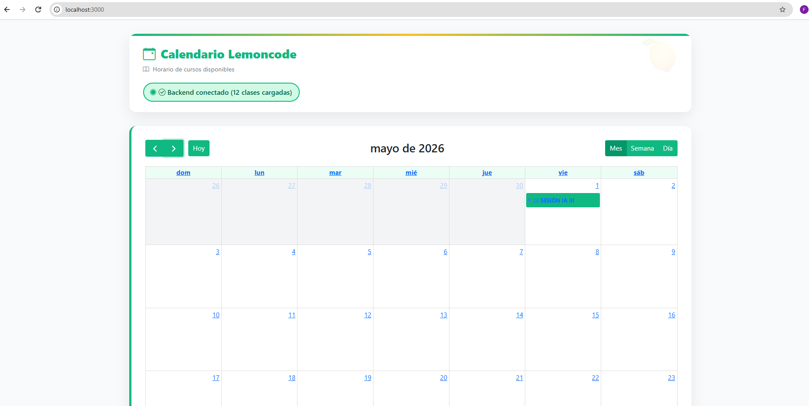

# Reto 3: Dockerizar el Frontend

El fichero Dockerfile ha sido generado usando el comando `docker init`.

Construcción de la imagen:

```bash
 docker build -t calendar-frontend:v1 .
```

Construcción del contenedor:

```bash
docker run -d \
 --name calendar-frontend \
 -p 3000:3000 \
 --network calendar-app-network \
 -e API_URL=http://calendar-backend:5000/api/classes calendar-frontend:v1
```

Acceso al frontend y visualización del calendario:


