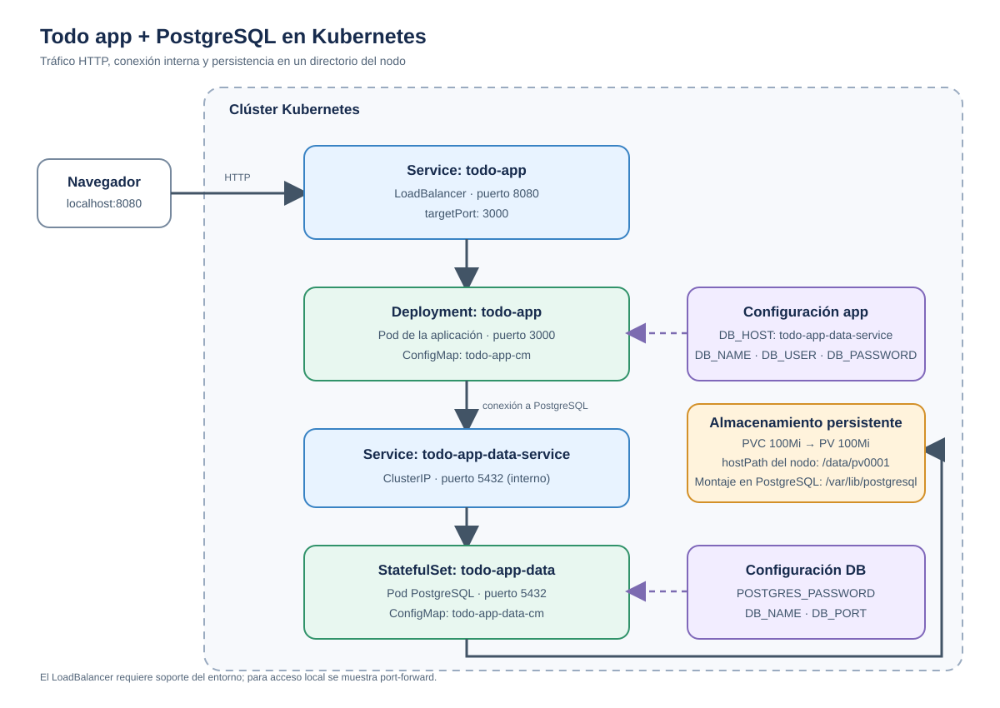

# Monolito con base de datos en Kubernetes

Este ejemplo despliega una aplicación web Todo y una base de datos PostgreSQL en Kubernetes. La app se expone mediante un Service `LoadBalancer`; PostgreSQL solo es accesible dentro del clúster y guarda sus datos en un volumen persistente basado en un directorio del nodo.



## Despliegue rápido

Desde esta carpeta, aplica primero la base de datos y después la aplicación:

```powershell
kubectl apply -f .\database\storage-class.yaml
kubectl apply -f .\database\
kubectl apply -f .\app\
```

Comprueba que los pods y el almacenamiento estén listos:

```powershell
kubectl get pods,svc,pv,pvc
```

Para abrir la aplicación desde tu equipo, mantén este comando activo en una terminal:

```powershell
kubectl port-forward svc/todo-app 8080:8080
```

Visita [http://localhost:8080](http://localhost:8080). El port-forward usa el puerto `8080` del Service y lo dirige al puerto `3000` del pod.

## Componentes y recorrido

| Componente | Función |
| --- | --- |
| `app/todo-app` Deployment | Ejecuta el contenedor de la aplicación en el puerto `3000`. |
| `app/todo-app` Service | Expone la app en el puerto `8080` y reenvía tráfico al puerto `3000`. Está declarado como `LoadBalancer`. |
| `app/todo-app-cm` ConfigMap | Proporciona configuración de ejecución y conexión a PostgreSQL. |
| `database/todo-app-data-service` Service | Da a la app un nombre DNS interno estable y enruta al puerto `5432` de PostgreSQL. |
| `database/todo-app-data` StatefulSet | Ejecuta una réplica de PostgreSQL. |
| `database/todo-app-data-cm` ConfigMap | Proporciona la contraseña inicial de PostgreSQL y otros parámetros. |
| `database/todo-app-data-pvc` PVC | Solicita `100Mi` de almacenamiento con la clase `todo-app-data-sc`. |
| `database/todo-app-data-pv` PV | Ofrece `100Mi` desde el directorio `/data/pv0001` del nodo. |
| `database/todo-app-data-sc` StorageClass | Usa `kubernetes.io/no-provisioner`: el PV se crea manualmente, no de forma dinámica. |

El flujo de solicitudes es:

1. El navegador llega al Service `todo-app` por el puerto `8080`.
2. El Service reenvía la solicitud al pod de la aplicación por el puerto `3000`.
3. La aplicación se conecta a `todo-app-data-service:5432`.
4. PostgreSQL guarda sus archivos en `/var/lib/postgresql`, montado desde el PVC.
5. El PVC se enlaza con el PV, cuyo directorio del nodo es `/data/pv0001`.

## Archivos

```text
01-monolith-in-db/
├── app/
│   ├── config-map.yaml
│   ├── deployment.yaml
│   └── lb-service.yaml
├── database/
│   ├── config-map.yaml
│   ├── ip-service.yaml
│   ├── pv.yaml
│   ├── pvc.yaml
│   ├── statefulset.yaml
│   └── storage-class.yaml
├── infraestructura.svg
└── README.md
```

## Notas importantes

- `LoadBalancer` solo obtiene una IP externa si el entorno Kubernetes proporciona un balanceador. En Minikube, puede permanecer como `<pending>`; para desarrollo local, usa `kubectl port-forward` como se muestra arriba.
- `hostPath` usa una ruta **del nodo Kubernetes**, no una carpeta del equipo anfitrión. Es apropiado para aprendizaje y pruebas, especialmente en un clúster de un solo nodo. En un clúster multinodo el directorio no se comparte y el pod puede necesitar el nodo que contiene los datos.
- Las contraseñas de ejemplo están en ConfigMaps y son texto plano. Usa Kubernetes Secrets y credenciales adecuadas antes de desplegar fuera de un entorno local de aprendizaje.
- La clase `todo-app-data-sc` no crea volúmenes automáticamente. El PV y el PVC deben existir y coincidir en clase, capacidad, modo de acceso y modo de volumen.
