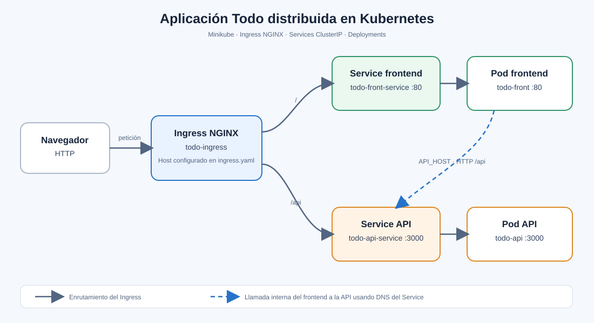

# Aplicación Todo distribuida en Kubernetes

Esta carpeta despliega la aplicación Todo en Minikube, separada en un frontend y una API. El Ingress NGINX recibe las peticiones HTTP y las enruta al servicio correspondiente.

## Arquitectura

El flujo de las peticiones es:

1. El navegador accede al host configurado en `ingress.yaml`.
2. El Ingress envía `/` al frontend y `/api` a la API.
3. Los Services `ClusterIP` encuentran los pods mediante sus selectores.
4. El frontend obtiene la URL de la API desde la variable `API_HOST`, configurada con el DNS interno del Service de la API.

## Componentes

| Recurso                      | Responsabilidad                                                  | Puerto |
| ---------------------------- | ---------------------------------------------------------------- | ------ |
| `todo-ingress`               | Enruta las peticiones por host y ruta mediante NGINX.            | HTTP   |
| Deployment `todo-front`      | Ejecuta `lemoncodersbc/lc-todo-front:v5-2024`.                   | 80     |
| Service `todo-front-service` | Expone el frontend dentro del clúster.                           | 80     |
| Deployment `todo-api`        | Ejecuta `lemoncodersbc/lc-todo-api:v5-2024` y comprueba `/live`. | 3000   |
| Service `todo-api-service`   | Expone la API dentro del clúster.                                | 3000   |
| ConfigMap `todo-front-cf`    | Configura `API_HOST` como `http://todo-api-service:3000/api`.    | —      |
| ConfigMap `todo-api-cf`      | Configura `NODE_ENV` como `development`.                         | —      |

Los Services son de tipo `ClusterIP`: ofrecen conectividad interna y no publican directamente los pods fuera del clúster. El Ingress es el punto de entrada HTTP.
