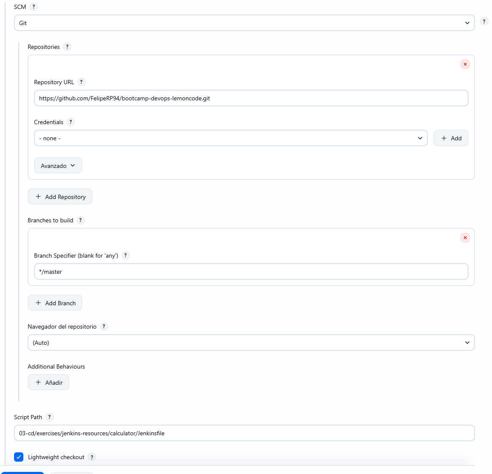

# Ejercicio 1: Pipeline básico de Jenkins

He resuelto el ejercicio haciendo un fork del repositorio del Bootcamp de DevOps de Lemoncode. La configuración de Jenkins utiliza el Jenkinsfile original del repositorio:

- **Jenkinsfile:** [03-cd/exercises/jenkins-resources/calculator/Jenkinsfile](https://github.com/FelipeRP94/bootcamp-devops-lemoncode/blob/master/03-cd/exercises/jenkins-resources/calculator/Jenkinsfile)
- **Repositorio fuente:** [FelipeRP94/bootcamp-devops-lemoncode](https://github.com/FelipeRP94/bootcamp-devops-lemoncode)
- También se incluye una copia local en [Jenkinsfile](./Jenkinsfile).

## Levantar el entorno

Desde la raíz del repositorio del Bootcamp, utilicé el Dockerfile [`03-cd/exercises/jenkins-resources/gradle.Dockerfile`](https://github.com/FelipeRP94/bootcamp-devops-lemoncode/blob/master/03-cd/exercises/jenkins-resources/gradle.Dockerfile) para preparar la instalación de Jenkins con Gradle.

Después construí la imagen y levanté el contenedor a partir del Dockerfile desde su directorio:

```bash
docker build -f 03-cd/exercises/jenkins-resources/gradle.Dockerfile -t jenkins-gradle .
docker run -d --name jenkins -p 8080:8080 -p 50000:50000 jenkins-gradle
```

## Configuración del pipeline

En Jenkins creé un pipeline configurado con Git como sistema de gestión de código fuente:

| Parámetro | Valor |
|---|---|
| Repository URL | `https://github.com/FelipeRP94/bootcamp-devops-lemoncode.git` |
| Credentials | Sin credenciales en la configuración SCM; el Jenkinsfile usa la credencial `git` durante el checkout |
| Branch Specifier | `*/master` |
| Script Path | `03-cd/exercises/jenkins-resources/calculator/Jenkinsfile` |
| Lightweight checkout | Activado |



El pipeline se ejecuta con `agent any` y contiene las siguientes etapas:

1. **Checkout code:** descarga la rama `master` del repositorio.
2. **Compile:** entra en el directorio de la calculadora y ejecuta `./gradlew compileJava`.
3. **Testing:** ejecuta `./gradlew test`.

## Ejecución y resultado

El detalle completo de la ejecución está disponible en [log-ejercicio-1.txt](./log-ejercicio-1.txt). El log confirma que Jenkins:

- Descargó y seleccionó el commit de la rama `master`.
- Compiló correctamente el proyecto con `BUILD SUCCESSFUL`.
- Ejecutó correctamente las pruebas con `BUILD SUCCESSFUL`.
- Finalizó la ejecución con `Finished: SUCCESS`.