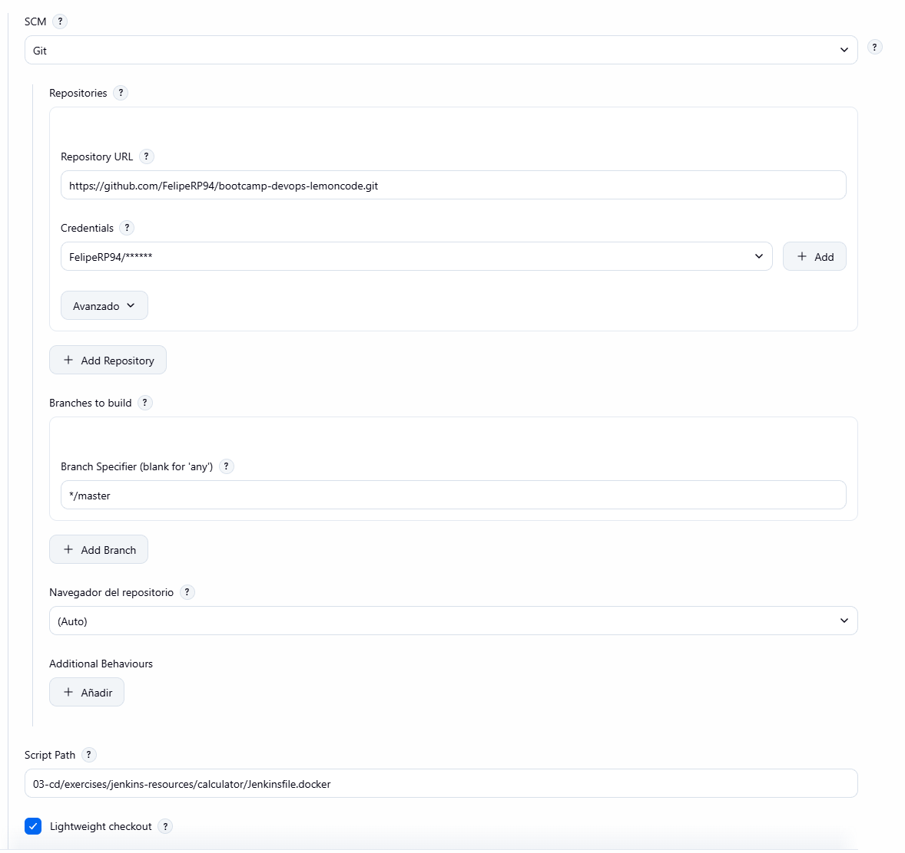

# Ejercicio 2: Pipeline de Jenkins con Docker

He resuelto el ejercicio haciendo un fork del repositorio del Bootcamp de DevOps de Lemoncode. La configuración de Jenkins utiliza el Jenkinsfile original del repositorio:

- **Jenkinsfile:** [03-cd/exercises/jenkins-resources/calculator/Jenkinsfile.docker](https://github.com/FelipeRP94/bootcamp-devops-lemoncode/blob/master/03-cd/exercises/jenkins-resources/calculator/Jenkinsfile.docker)
- **Repositorio fuente:** [FelipeRP94/bootcamp-devops-lemoncode](https://github.com/FelipeRP94/bootcamp-devops-lemoncode)
- También se incluye una copia local en [Jenkinsfile](./Jenkinsfile).

## Levantar el entorno

Desde la raíz del repositorio del Bootcamp, levanté el entorno de Jenkins ejecutando Docker Compose en el directorio `03-cd/00-instalando-jenkins`:

```bash
cd 03-cd/00-instalando-jenkins
docker compose up
```

## Configuración del pipeline

En Jenkins creé un pipeline configurado con Git como sistema de gestión de código fuente:

| Parámetro | Valor |
|---|---|
| Repository URL | `https://github.com/FelipeRP94/bootcamp-devops-lemoncode.git` |
| Credentials | Credencial Git configurada con el identificador `git` |
| Branch Specifier | `*/master` |
| Script Path | `03-cd/exercises/jenkins-resources/calculator/Jenkinsfile.docker` |
| Lightweight checkout | Activado |



El pipeline se ejecuta dentro de un contenedor basado en la imagen `gradle:6.6.1-jre14-openj9` y contiene las siguientes etapas:

1. **Checkout code:** descarga la rama `master` del repositorio.
2. **Compile:** entra en el directorio de la calculadora y ejecuta `./gradlew compileJava`.
3. **Testing:** ejecuta `./gradlew test`.

## Ejecución y resultado

El detalle completo de la ejecución está disponible en [log-ejercicio-2.txt](./log-ejercicio-2.txt). El log confirma que Jenkins:

- Descargó la imagen Gradle especificada por el pipeline.
- Descargó y seleccionó el commit de la rama `master`.
- Compiló correctamente el proyecto con `BUILD SUCCESSFUL`.
- Ejecutó correctamente las pruebas con `BUILD SUCCESSFUL`.
- Finalizó la ejecución con `Finished: SUCCESS`.
